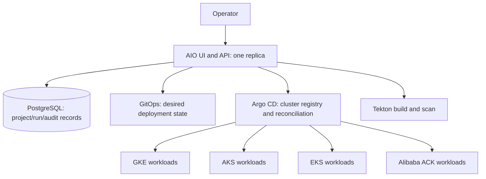

# Central management and migration tracking

Observed on 2026-11-14: the existing AIO control plane has one desired replica on GKE. Dev, staging and prod currently map to the in-cluster destination. AIO background workers are not generally coordinated for multiple replicas.

## Recommended topology

The existing management cluster is the hub. AIO records projects, runs, environment mapping, deployment observations and audit events. Argo CD holds workload-cluster credentials and reconciles deployments. GitOps records desired image/configuration revisions. These responsibilities already provide the foundation for a central inventory; a new VM is not required merely to know which cluster an environment targets.

Current limits: one destination per environment, configured through cluster mappings. The current migration behavior can move/delete old environment resources, so it is not a safe substitute for a traffic/data migration workflow. A complete migration tracker still needs explicit source/target, data-replication state, cutover approval, traffic weights, rollback window and completion evidence. Provider catalog entries are capability descriptions, not connected instances. An application running simultaneously across providers needs separate workload instances plus DNS/traffic routing, data consistency and failure handling. More replicas of the AIO API do not implement that architecture.

## Migration sequence

1. Keep the current hub running; register an authorized existing test cluster in Argo CD.
2. Record source and target context, application/image digest, database placement, persistent storage and domain/traffic ownership.
3. Validate the target using a disposable project and test hostname; preserve the source serving application.
4. Rehearse data transfer/replication and validate application reads/writes, TLS, identity, logs and rollback.
5. Only then approve production cutover with an explicit traffic/data plan. Do not change production environment mappings as a discovery step.
6. Observe the target through the rollback window, retain evidence/backups, and retire source resources only after approval.

## Optional free VM

An optional VM can be a private administration runner, VPN endpoint or independent health monitor. It should not become an unbacked-up single source of truth. Keep desired state in Git and operational records/backups in PostgreSQL and durable storage.

Oracle lists Always Free compute subject to account/region eligibility and capacity; Azure free services depend on new-account eligibility and time limits; AWS's current free plan depends on credits and its limited duration. Verify the actual account offer, architecture, storage/public-IP/egress charges and recovery requirements before provisioning. The existing AIO image is built for its current platform; an ARM VM would require a compatible verified image, not an assumption that the existing digest runs there. No VM has been created as part of this work.

Sources checked on 2026-11-14: [Oracle Free Tier](https://www.oracle.com/cloud/free/), [Oracle capacity FAQ](https://www.oracle.com/cloud/free/faq/), [Azure account offers](https://azure.microsoft.com/en-us/pricing/purchase-options/azure-account), [AWS free-plan FAQ](https://aws.amazon.com/free/free-tier-faqs/).
