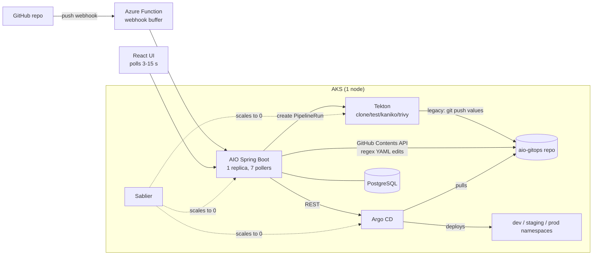
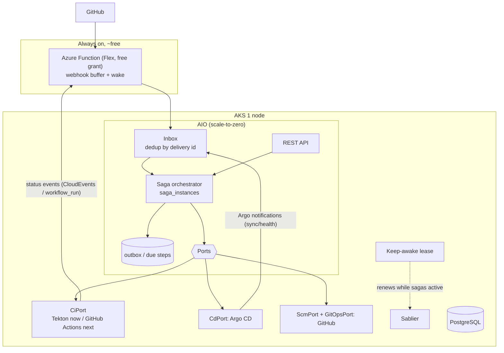

# AIO v2: architecture review and target design

Status: **proposal** (16 Nov 2026). Phase 1 is implemented on branch `feat/aio-v2-saga-core`; nothing is deployed.
Audience: whoever builds or operates AIO next. Read §1–2 for how AIO works today, §3–5 for the target, and §7 for the plan.

## 1. What AIO is today

AIO is an internal developer platform. A developer picks a template or a GitHub repo, and AIO builds, scans and deploys
it to dev → staging → prod through GitOps.

### 1.1 Workflows

| Workflow | Steps (systems) | State kept in | On failure mid-way |
|---|---|---|---|
| Create project | GitHub read → DB row → namespaces → 3 values-file commits → 3 Argo apps → webhook → first run | `projects` row only | Row exists; a retry says "already exists"; repair skips missing values files → project stays broken |
| Create from template | GitHub repo generate → wait (sleeps up to 60 s in the request) → file commits → create project | none | GitHub repo orphaned; a retry fails |
| CI run | DB row → Tekton PipelineRun (retry sleeps in the request) → polled every 4 s | `ci_runs`, `run_steps` | LEGACY runs can stay PENDING forever; an ambiguous create is marked FAILED while the build may still deploy |
| Release to dev (independent mode) | queue in `ci_runs` → GitHub commit **inside a DB transaction with a row lock** | `ci_runs.release_*` | Retries with backoff (good); `COMMITTED` ≠ deployed |
| Promotion / rollback | commit tag → (prod) Argo refresh + sync | `promotions` | Tag committed but row FAILED → the next sync deploys an "unapproved-looking" change; concurrent approvals both apply |
| Domain add/remove | DB → route render commits → cert polling every 60 s | `domains` | Remove deletes the row first; a failed render leaves the route live forever |
| Cluster move | delete app → poll 4 min → recreate | nothing | A crash leaves the app deleted |
| Scan | PipelineRun → findings parsed from **pod logs** | `scan_runs` | Pod gone → silently no findings |

### 1.2 Background work (one pod, one scheduler thread)

PipelineWatcher 4 s · ScanWatcher 4 s · BuildReleaseWorker 5 s · DeploymentPoller 15 s (3 Argo calls × projects) ·
RegistryRunCleanup 30 s · DomainWatcher 60 s · prune 10 min · full reconcile of every project at each start ·
SSE streams poll the DB every 2 s.

All `@Scheduled` methods share Spring's **single** scheduler thread, and there is no leader election.
On Azure, `AIO_WORKERS_ENABLED=false`, so release commits, deploy status and certificate checks **do not advance at all**.

### 1.3 What it costs to keep it running

- **AIO, Argo CD and Tekton sleep after 30 min idle (Sablier)**, but:
  - The UI polls every 3–15 s and never pauses for hidden tabs, so **one open tab keeps all three awake**.
  - CI needs Tekton plus a fresh 2 GiB Azure Disk per run, up to 2 GiB of RAM and 0.9 CPU on a 1.9-CPU node.
  - Builds run at priority 0, so they can be preempted.
- **Always-on regardless:** Traefik, cert-manager, PostgreSQL, Sablier, the Tekton webhook (needed for CRD conversion) and the public sites.

### 1.4 Root causes

1. **No durable workflow model.** Multi-system operations are plain method calls. Progress lives in other systems (Git file contents, Argo status) or nowhere.
2. **No idempotency or deduplication.** Webhook deliveries, PipelineRun creation and approvals can all happen twice.
3. **Polling instead of events.** That costs CPU and API calls, and it fights scale-to-zero.
4. **Concrete clients everywhere** (GitHub, Tekton, Argo, fabric8). Swapping CI or CD means touching 5+ services, and workflows can't be unit tested.

## 2. Design principles for v2

| Principle | Meaning for AIO |
|---|---|
| **Zero idle** | Nothing runs or polls when nobody is working. Work is triggered by an event (webhook, user action, timer due in the DB) and the process may sleep between events. |
| **Durable workflows (orchestrated sagas)** | Every multi-system operation is a saga instance in PostgreSQL: ordered steps, retry with backoff, deadline, compensation. A restart or a scale-to-zero resumes exactly where it stopped. |
| **Idempotent everything** | Each step has an idempotency key (`saga id + step`). Steps are "ensure X" rather than "do X": read before write, compare before commit, find by label before create. Inbound events are deduplicated (inbox). |
| **Transactional outbox** | A DB change and "do the remote thing next" are committed together. **No remote call ever runs inside a DB transaction.** |
| **Events first, polling as backstop** | CI and CD push status to AIO (CloudEvents / webhooks). A slow reconcile sweep (minutes, only while awake) repairs anything missed. |
| **Ports and adapters** | `ScmPort` (GitHub), `CiPort` (Tekton or GitHub Actions), `CdPort` (Argo CD), `GitOpsPort`, `RegistryPort`, `Clock`. Workflows depend on ports only. |
| **GitOps is the desired state** | Every deploy-affecting change is a Git commit. The DB records *intent and progress*, never a second copy of desired state. |
| **One writer per values file** | Only the release/promotion sagas edit `image.*`; the legacy Tekton `update-gitops` push goes away. |

## 3. Target architecture

### 3.1 Saga engine (in-process, PostgreSQL-backed)

A small library inside AIO, not a new service. That keeps idle cost at zero and avoids running Temporal or Kafka.

- **`saga_instances`:** `id, type, business_key (unique), status, step, data (JSON), attempts, next_attempt_at, deadline_at, last_error, version, created_at, updated_at`.
  - Status is one of `RUNNING | WAITING | COMPENSATING | SUCCEEDED | FAILED | COMPENSATED`.
- **`saga_events`:** an append-only history of each transition (step, outcome, message, at). This is the audit trail and the UI timeline.
- **Definition:** an ordered list of steps. Each step has an `execute(ctx)` returning `Done`, `Wait(until)`, `Retry(error)` or `Fail(error)`, and an optional `compensate(ctx)`.
- **Execution rules:**
  1. Claim a due instance with optimistic locking (`version`).
  2. Run **one** step **outside** any transaction.
  3. Persist the outcome and the next due time in a short transaction.
  - A crash between 2 and 3 re-runs the step, which is safe because steps are idempotent.
- **Worker:** wakes on (a) a new or changed saga (in-process signal) or (b) the earliest `next_attempt_at`. It sleeps when nothing is due, so there is **no fixed-rate polling**.
- **Retries and failure:** exponential backoff with jitter. When a step fails for good or the deadline passes, the engine runs compensations for completed steps in reverse, then marks the saga `COMPENSATED`; if a compensation itself fails, the saga is `FAILED` and flagged for a human.

### 3.2 The sagas

| Saga | Steps (→) and compensations (↺) | Key |
|---|---|---|
| **ProvisionProject** | Validate repo → insert project ↺ delete row → ensure namespaces → ensure 3 values files ↺ delete files → ensure 3 Argo apps ↺ delete apps → ensure webhook ↺ delete webhook → start **Release** | `project:<name>` |
| **CreateFromTemplate** | Generate repo ↺ archive/delete repo → wait until contents exist (`Wait`, not `sleep`) → commit generated files → **ProvisionProject** | `template:<owner>/<repo>` |
| **Release** (per commit) | Start CI (find-by-label before create) → await CI result (event; `Wait` backstop) → gate (scan policy, trust tier) → commit digest to dev values (compare-and-set) → await Argo healthy on that revision → `SUCCEEDED` | `release:<project>:<sha>` |
| **Promotion** | (prod) await approval → capture current tag → commit new tag ↺ restore captured tag → (prod) refresh + sync ↺ sync → await healthy on new tag (deadline) → done | `promotion:<id>` |
| **DeleteProject** | Delete Argo apps (cascade) → await gone → delete values files → delete webhook → delete registry secrets → delete row | `delete:<project>` |
| **Domain** | Commit routes → await DNS → await certificate → ready; removal: commit routes without host → then delete row | `domain:<host><path>` |

### 3.3 Events in, no polling

| Source | Today | v2 |
|---|---|---|
| GitHub push / PR | Synchronous build start in the webhook request, no dedup | Function → `/api/webhooks/github` → **inbox row** (unique `X-GitHub-Delivery`) → `202` at once → Release saga |
| CI status | PipelineWatcher every 4 s | Tekton CloudEvents sink (or GitHub `workflow_run` webhook) → inbox → `saga.signal()`; backstop check at 2 min |
| CD status | DeploymentPoller every 15 s | Argo CD Notifications webhook on sync/health change → inbox; backstop sweep every 10 min while awake |
| Certificates | DomainWatcher every 60 s | Domain saga `Wait` with backoff (1, 2, 5, 15 min…), only while a domain is pending |
| UI | Fixed 3–15 s polls, also in hidden tabs | Pause when the tab is hidden; SSE only on the run detail page |

### 3.4 Scale-to-zero contract

- **Wake:**
  - A user opening AIO.
  - The Function delivering a webhook or a CI/CD event. It buffers while AIO starts, which is already live.
- **Stay awake:** while any saga is `RUNNING` or due within 15 min, AIO renews its own Sablier session (keep-awake lease). Builds never stall because the tab was closed.
- **Sleep:** 30 min after the last request **and** no active saga. The 23:00 IST hard stop remains.
- **Resume:** on start, the worker picks up due sagas. There is no full reconcile at startup; the reconcile sweep is lazy and incremental.

## 4. Cost model

Monthly list prices, South India; Central India is about half.

| Item | Today | v2 | How |
|---|---|---|---|
| Node (B2as_v2) | 77 | 77 (36 in Central India; 21 with a reservation) | CPU requests right-sized; v2 removes Tekton, so builds no longer force a 2nd node |
| 2nd node during builds | ~2–8 | **0** | **CI on GitHub Actions** (free minutes) instead of Tekton + kaniko + per-run disks |
| Per-run 2 GiB disks | cents, but slow attach | **0** | No Tekton |
| Load balancer + IPs | 25 | 25 | The AKS floor; only a VM + k3s design removes it |
| Function + storage | ~0 | ~0 | Free grant |
| **AIO awake time** | hours (open tabs) | minutes per change | Hidden-tab pause + keep-awake only while work runs |

**The cheapest end state:** one Central India node with a 1-year reservation, CI on GitHub Actions, AIO and Argo asleep
by default. That is ≈ **US$55–60/month**, down from ≈ US$330 at migration day.
Below that, the only bigger lever is leaving AKS for a single VM running k3s (≈ US$40–45/month), at the price of managed upgrades.

## 5. Decisions needed

1. **CI executor:** move builds to GitHub Actions (recommended: zero idle, no node pressure, free for public repos and 2,000 min/month private), or keep Tekton.
2. **Turn on the release workers on Azure**, which is safe once the sagas replace the pollers. Today `AIO_WORKERS_ENABLED=false` means independent releases never commit.
3. **Retire the legacy pipeline path** (Tekton `update-gitops` git push, Tekton EventListener, legacy ApplicationSet) so that only the sagas write `image.*` values.
4. **Set `APPROVERS`.** Empty today, which lets anyone (but the requester) approve prod.

## 6. Security improvements folded in

- Store webhook secrets encrypted, or hashed if only verification is needed. Today they are plaintext.
- Use a GitHub App with per-repo installation tokens instead of one `GITHUB_TOKEN` that does everything, including the ghcr pull secret copied into namespaces.
- Never mount the push-capable token into PR builds from forks; build PRs on GitHub Actions with read-only permissions.
- Remove the token-in-URL clone in `update-gitops`, which goes away with the legacy path.

## 7. Roadmap

| Phase | Scope | Exit criteria |
|---|---|---|
| **1 (branch, tonight)** | Saga engine + tables; Promotion as a saga (fixes the FAILED-but-committed bug and the approval race); webhook inbox with delivery dedup + same-commit dedup; keep-awake lease; UI hidden-tab pause; stuck-PENDING fix; scheduler pool | All tests green; PR opened; nothing deployed |
| 2 | Release saga replaces PipelineWatcher + BuildReleaseWorker; Tekton CloudEvents; enable workers on Azure; retire `update-gitops` | One writer per values file; a dev release in ≤ 1 event hop |
| 3 | `CiPort` with a GitHub Actions adapter (`workflow_dispatch` + `workflow_run`); Tekton optional | Builds without Tekton awake; no per-run disks |
| 4 | ProvisionProject / CreateFromTemplate / DeleteProject / Domain sagas; Argo notifications; drop DeploymentPoller | No fixed-rate pollers left |
| 5 | GitHub App, encrypted secrets, Central India move + reservation | Cost ≈ US$55–60/month |
