# User GitHub connections and independent build/deployment flows

**Status:** target architecture; independent delivery implementation in progress, user GitHub connection work pending. **Date:** 2026-11-13. See [implementation status and activation](IMPLEMENTATION.md).

This extends the [architecture plan](README.md). Users should be able to connect GitHub, create a repository in their own account or an authorized organization, select an existing repository, and build it through AIO. GitHub integration is optional for AIO sign-in. Tekton remains the initial build engine and Argo CD remains the deployment engine, with a durable release contract between them.

## Current constraints

- AIO signs users in through Keycloak/OIDC. GitHub social sign-in does not supply repository authorization.
- `GitHubController` lists existing owned project repositories for regular users; administrators can list repositories using the configured platform credential.
- `GitHubClient` uses a configured shared client. `TemplateService` creates repositories under the configured GitOps owner, rather than a user-selected GitHub account.
- `TektonService` passes GitOps location and deploy settings into `ci-pipeline`. The pipeline's `deploy-dev` task writes GitOps with the same GitHub workspace used for cloning source.
- `PipelineWatcher` already reads commit, image URL, digest, and scan results from TaskRuns. These provide a starting point for a durable build result.

Sources: [GitHubController](../../platform/backend/src/main/java/com/aio/platform/web/GitHubController.java), [GitHubClient](../../platform/backend/src/main/java/com/aio/platform/service/GitHubClient.java), [TemplateService](../../platform/backend/src/main/java/com/aio/platform/service/TemplateService.java), [TektonService](../../platform/backend/src/main/java/com/aio/platform/service/TektonService.java), [PipelineWatcher](../../platform/backend/src/main/java/com/aio/platform/service/PipelineWatcher.java), [pipeline](../../tekton/pipelines/ci-pipeline.yaml).

## Target boundaries

```mermaid
flowchart LR
    User[User signed in through OIDC] --> Connect[Optional GitHub connection]
    Connect --> Source[Create or select source repository]
    Source --> Intent[AIO authorized build intent]
    Hook[Verified GitHub webhook] --> Intent
    Intent --> Build[Build adapter: Tekton initially]
    Build --> Registry[OCI registry: immutable image digest]
    Build --> Result[Persist build result and outbox atomically]
    Result --> Policy[AIO release policy and approval]
    Policy --> Release[Durable release request]
    Release --> Writer[GitOps writer with separate credential]
    Writer --> Git[Desired-state Git repository]
    Git --> Argo[Argo CD reconciliation]
    Argo --> Cluster[Application workload]
    Argo --> Observe[AIO deployment observation]
    Result --> Feedback[Optional GitHub checks]
    Observe --> Feedback
```

Source code, container images, and desired deployment state are separate resources. Connecting GitHub does not grant registry push access or Kubernetes access. Keep platform-managed GitOps as the initial deployment option. User-owned registries, repository configuration, artifact trust tiers, and SSO tool UIs are now included in the next architecture scope: see [registry, trust, and tool UI plan](REGISTRY-TRUST-AND-TOOL-UIS.md). User-owned GitOps remains a later extension with explicit authorization and validation.

## GitHub connection and repository creation

Use a GitHub App with user authorization for interactive actions and installation authorization for approved background repository operations. This is separate from the GitHub identity provider used by Keycloak. The app's installation repository selection limits automation access; a connected account alone does not authorize every repository. GitHub documents these [authorization differences](https://docs.github.com/en/apps/oauth-apps/building-oauth-apps/differences-between-github-apps-and-oauth-apps).

1. In Profile & settings, the user selects **Connect GitHub**. Bind a short-lived, single-use OAuth state to the existing AIO issuer/subject and session. Validate the callback and retrieve the GitHub numeric user ID from GitHub; never link by matching email or login name.
2. The user authorizes the app and installs it on their personal account or an organization. Verify installation/account access server-side; an installation ID supplied by the browser is insufficient evidence. Organization approval may leave the connection awaiting installation.
3. List only repositories accessible to both the requesting GitHub user and the installation, with pagination. Recheck authorization when creating a project or starting new work. GitHub access does not grant access to another user's AIO project.
4. Offer **Use existing repository**, **Create empty repository**, and **Create from template**. Show destination account, name, visibility, template, and initial branch. Validate personal/organization creation permissions with the endpoint's supported token type. Personal creation uses a GitHub App user access token; organization and template creation require their own permission checks. See [GitHub repository endpoints](https://docs.github.com/en/rest/repos/repos#create-a-repository-for-the-authenticated-user).
5. Persist a repository-creation operation before calling GitHub. Record the returned numeric repository ID and actual default branch, then confirm the repository is included in the installation's selection. If selection must be updated, show **Repository created; grant AIO access** and resume onboarding afterward.
6. Resume project onboarding and submit the first build only when source is available. An empty repository waits for its first commit; do not submit a build against a nonexistent branch. A template flow can initialize reviewed container files before the first build.
7. Disconnect or installation revocation blocks new GitHub work and cancels queued work that no longer has access. Preserve project/build/deployment history and existing deployed workloads. Reconnection requires authorization again. Do not delete the user's repository as onboarding compensation.

Create retries must reconcile with the operation's saved repository ID. A repository found at the requested name after a timeout is not automatically proof that this operation created it; unresolved ownership/provenance requires review rather than adopting or deleting it.

Keep user/refresh tokens encrypted through a credential store reference, with key rotation and expiry metadata. Mint installation tokens for the minimum repository and permissions required; GitHub supports [repository-scoped installation tokens](https://docs.github.com/en/apps/creating-github-apps/authenticating-with-a-github-app/generating-an-installation-access-token-for-a-github-app). Never send tokens to the frontend or persist them in run parameters, logs, or outbox payloads. Account for token expiry during long builds and retries by reacquiring credentials at the authorized step boundary.

Build source credentials must be scoped to the selected repository and exposed only to the clone task. Registry push credentials belong only in build tasks. GitOps write credentials must never enter user build pods. Clean up temporary Secrets after completion and through a recovery sweeper after crashes. Namespace, service-account, workspace, and network isolation must prevent one user's arbitrary test/build commands from reading another user's credentials. Fork pull requests receive no privileged source, registry, or deployment credentials; initially require explicit trusted execution or reject such builds.

Use the GitHub App webhook subscription for new connections rather than creating individual repository hooks. Verify the raw-body signature and deduplicate by provider, app, and delivery ID; track dispatch per AIO project because one repository can serve multiple projects. Verify repository ID, installation, event action, ref/SHA, and project binding before scheduling. Handle uninstall, suspension, permission changes, repository transfer, and removal from selection. Recheck provider access before new side effects to cover delayed webhooks. Migrate existing hooks without double-triggering builds.

Optional GitHub feedback uses separate checks for build and deployment, keyed to the exact commit. Link to ownership-protected AIO logs. Reporting retries must not rerun a build or deployment. A failed deployment check must not change a successful build check. GitHub Actions is a possible future build adapter, not part of this initial change.

## Durable release handoff

Tekton performs clone, test, image build/push, and scan. It returns a versioned result with project ID, AIO run ID, provider run UID, repository ID, full commit SHA, image repository, immutable digest, scan outcome/policy version, artifact references, and completion time. Export stable Pipeline results rather than making downstream release logic depend on task names. Tekton supports [Pipeline results](https://tekton.dev/docs/pipelines/pipelines/#emitting-results-from-a-pipeline).

The build observer validates those results against the submitted run and persists the terminal build result and outbox event in one database transaction. A release-policy consumer uses the deploy intent captured at submission, current authorization, environment policy, and verified scan gate to create a release request. Results from untrusted builds cannot select a destination project, GitOps path, or approval policy.

| Boundary | Responsibility |
| --- | --- |
| Build adapter | Submit, observe, cancel, and read logs; expose provider-neutral build results |
| Release policy | Decide eligibility and target environment; require approval for production; deny automatic deployment for PR builds |
| Release worker | Claim durable work, authorize, serialize environment updates, and reconcile Git writes |
| GitOps writer | Commit only the authorized application's owned values, pinned to image digest; return Git commit SHA |
| Deployment adapter | Observe desired revision, live image digest, sync, and health; optionally request an explicit approved sync |
| GitHub feedback adapter | Publish separate build/deployment checks without controlling delivery |

Remove `deploy-dev`, GitOps parameters, and GitOps write access from the new Tekton pipeline. Preserve automatic dev deployment as AIO policy for eligible default-branch builds. Allow build-only projects with no Argo application prerequisites. Deployment retry, promotion, and rollback reuse a verified artifact without rebuilding.

Argo CD watches Git and reconciles independently. Automatic sync removes the need for CI to call its API, as described in [Argo CD's sync documentation](https://argo-cd.readthedocs.io/en/latest/user-guide/auto_sync/). Retain an Argo adapter for onboarding, observation, and production's explicit approved sync where automated sync is disabled. Those calls belong to deployment operations and do not participate in build success.

Use independent state machines:

- Build: `QUEUED -> RUNNING -> SUCCEEDED | FAILED | CANCELLED`.
- Release: `REQUESTED -> WAITING_APPROVAL | READY -> COMMITTING -> COMMITTED -> OBSERVING -> HEALTHY | DEGRADED | SUPERSEDED`; denied, cancelled, blocked, and retry-wait outcomes remain explicit.
- External observation: record freshness and last error separately. An unavailable Argo API means unknown/stale observation, not proof of a failed rollout.

`COMMITTED` means Git accepted the desired state. `HEALTHY` requires observing the intended Git revision and image digest with acceptable workload health. A healthy older revision does not complete a newer request. A GitOps or Argo outage leaves a successful build intact and a release waiting for recovery. A normal scan failure cannot create an eligible release; any permitted exception follows the existing audited, digest-bound approval policy.

Use at-least-once delivery with unique consumer keys, not an exactly-once claim. Uniquely identify result events by provider run UID and result schema version, and releases by project, environment, build result, and deployment intent ID. Intent ID allows an explicitly requested redeployment without duplicating a redelivered event. Claim jobs with leases and version checks. Reconcile a timed-out Git write before retrying, and retain the accepted commit SHA.

Serialize writes per project/environment and compare an environment intent generation before committing. Older builds finishing late must not overwrite newer desired releases. A deliberate rollback is a new authorized generation and may reference an older digest. On Git conflicts, reread and preserve unrelated values; never force push. A superseded release cannot be declared healthy merely because another release reconciled.

## Proposed persistence and API contracts

Names are illustrative; use additive Flyway migrations and align them with the main operation/outbox design.

| Record | Important fields/invariants |
| --- | --- |
| GitHub connection | AIO issuer/subject, GitHub numeric user ID, credential reference, granted permissions, expiry, connection state |
| Installation binding | Connection, installation/account IDs, verified user access, selection/permission state; organization installations may serve multiple independently authorized connections |
| Project source binding | Project ID, repository ID, installation binding, last-known URL/default branch; unique per project, allowing several projects per repository |
| Repository creation operation | Actor, idempotency key, requested destination/name/template, external repository ID, step outcomes |
| Build result | Run ID/provider UID, full SHA, immutable image digest, gate evidence, schema version; immutable once validated |
| Release request | Project/environment, intent generation, build result, actor/approval evidence, policy, desired digest, Git commit, state/version |
| Inbox/outbox/job | Deduplication key, schema version, actor/resource references, attempts, next attempt, lease; no credentials |

Proposed connection endpoints cover status, authorization start/callback, verified installations, paginated repositories, and disconnect. Repository creation returns `202 Accepted` and an operation ID. Build APIs return run status; release APIs return release and observed deployment status separately. Apply existing role checks, issuer/subject ownership, CSRF protection on mutations, safe redirects, and sanitized errors. OAuth and webhook callbacks have their own state/signature validation. Connection authorization must never elevate a community user's AIO role.

## Delivery sequence and acceptance

1. Add connection storage, GitHub App configuration, authorization callbacks, revocation handling, and ownership checks. Keep legacy projects explicitly marked as platform-managed; never silently fall back to the platform token when a user connection fails.
2. Add per-user repository discovery and resumable repository/template creation. Test personal accounts, organizations awaiting approval, private repositories, empty repositories, and installation selection changes.
3. Introduce a versioned build-only pipeline alongside the existing pipeline. Persist validated results and outbox records; introduce release requests, environment generation control, and digest support in the Helm values/chart and GitOps writer before enabling releases.
4. Switch selected projects to the new build/release mode. Capture pipeline version and deployment mode per run: legacy runs retain their legacy GitOps handoff, while new runs use only the release worker. Never let both paths update an environment for one run. Retire legacy GitOps task credentials after all old runs finish.
5. Add optional GitHub checks. Broaden rollout only after recovery and security acceptance cases pass. Start with the existing PostgreSQL worker/outbox model; no broker or additional microservice is required.

Required acceptance cases include cross-user connection/repository access denial, OAuth state replay, organization access loss, revocation while queued, clone token expiry, Secret isolation, duplicate webhook delivery, repository-created/onboarding-failed recovery, restart after build success but before dispatch, Git commit accepted with lost response, conflicting concurrent writes, out-of-order build completion, explicit rollback, scan failure, PR build-only enforcement, and stale Argo observation. Prove that builds finish during an Argo outage and that releases recover without rebuilding or duplicate commits. Show build, GitOps commit, rollout, and GitHub feedback states separately in the UI.
