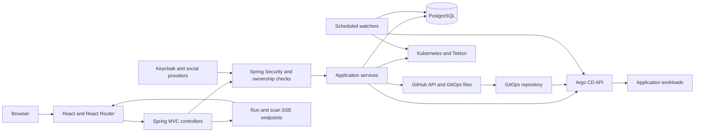
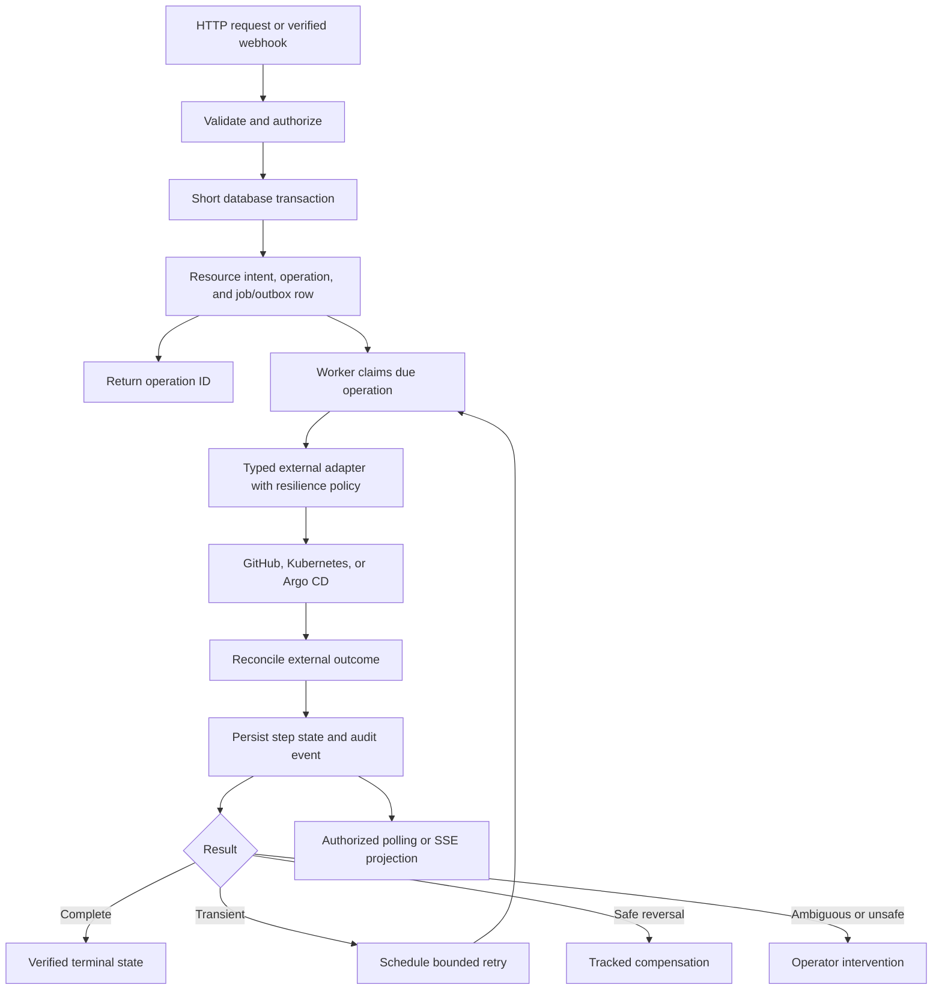

# AIO application flow and engineering improvement plan

**Status:** implementation and migration blueprint; implementation in progress. **Updated:** 2026-11-13. See [implementation status and activation](IMPLEMENTATION.md) for code delivered and remaining acceptance work.

This document maps the application as it exists, then proposes a target flow and coding standards. Proposed components, tables, states, and resilience settings are **not implemented** by this document.

## 1. Scope and recommendation

The primary application is AIO: the React portal and Spring Boot backend in `platform/`, with PostgreSQL, GitHub, Tekton, Argo CD, Kubernetes, and Keycloak/User Profile Manager. Learn (`sarvaikam`) and the organization homepage (`sarvaikam-home`) are separate workloads deployed by AIO. They must not be treated as the same project because they share a source repository.

Keep AIO as a **modular monolith** for now. Introduce durable orchestration for operations that span the database and external systems. Use saga-style compensation selectively where reversal is safe. Add timeouts, bounded retries, circuit breakers, and bulkheads at external integration boundaries. Preserve Tekton's build orchestration and Argo CD's deployment reconciliation rather than replacing them with another general-purpose workflow engine.

The initial goal is reliable recovery and clearer code boundaries. Keep those boundaries suitable for future microservices: independent data ownership, explicit contracts, and replaceable integration adapters.

Companion documents: [database and infrastructure audit](DATABASE-AUDIT.md), [migration and extraction runbook](MIGRATION.md), [user GitHub connections and independent delivery](GITHUB-AND-DELIVERY.md), and [Terraform deployment runbook](../../infra/README.md).

The GitHub/delivery companion specifies the target additions: optional per-user GitHub App connections, repository creation in authorized user/organization accounts, and a durable build-result/release boundary. Tekton builds and scans; AIO release workers update GitOps; Argo CD reconciles independently. The current-flow descriptions below describe the existing shared-credential pipeline, including its direct GitOps update, until that migration is implemented. Build-only projects in the target flow do not require Argo onboarding.

The [registry, artifact trust, and tool UI plan](REGISTRY-TRUST-AND-TOOL-UIS.md) adds user registries declared in `.aio/project.yaml` with separate credentials, Normal/Verified/Golden artifact policies, approved Tekton build profiles, and upstream Argo CD/Tekton UIs using the existing AIO identity provider with separate clients and scoped authorization. It defines implementation and test gates before technology deep dives; these capabilities are not yet implemented.

[Application autoscaling](HYBRID-AUTOSCALING.md) adds opt-in CPU plus Istio request-rate scaling to the shared workload chart. AIO itself remains single-replica. Metrics infrastructure and live workload activation require their own readiness checks.

## 2. Current architecture



### 2.1 Sign-in and authorization

1. The browser enters `/oauth2/authorization/profile`.
2. Spring Security redirects to the configured Keycloak realm. GitHub or Google sign-in is brokered there; AIO receives OIDC identity claims, not a personal GitHub repository token.
3. `ProfileOidcUserService` checks access policy, records the identity, and maps AIO client roles to application authorities.
4. `/api/me` supplies the user's name, login, access tier, and approval capabilities.
5. `SecurityConfig` applies endpoint-level role rules. `OwnershipConfig` guards resource detail, action, log, report, and stream paths. `UserScope` identifies ownership using issuer plus subject.
6. Collection endpoints and metrics query the current user's authorized resources. Admins retain global access. Regular audit feeds are scoped by actor subject.
7. The profile/settings panel owns workspace appearance controls. The bell opens the authorized audit feed and links to `/audit`.

**Sources:** [SecurityConfig](../../platform/backend/src/main/java/com/aio/platform/config/SecurityConfig.java), [OwnershipConfig](../../platform/backend/src/main/java/com/aio/platform/config/OwnershipConfig.java), [UserScope](../../platform/backend/src/main/java/com/aio/platform/security/UserScope.java), [ProfileOidcUserService](../../platform/backend/src/main/java/com/aio/platform/security/ProfileOidcUserService.java), [AccountControls](../../platform/frontend/src/components/AccountControls.jsx).

### 2.2 Project onboarding

`POST /api/projects` currently performs a sequence of synchronous service calls:

```text
Validate request and repository access
  -> read repository metadata from GitHub
  -> save Project, including owner identity and build settings
  -> ensure each environment's Kubernetes prerequisites
  -> initialize GitOps values files
  -> create/update dev, staging, and prod Argo applications
  -> optionally register the GitHub webhook
  -> record project creation
  -> save an initial CiRun and submit its Tekton PipelineRun
```

Webhook registration failure is caught and audited; the remaining onboarding can continue. Failures earlier in the sequence can leave a saved project and some external resources without completing the rest. There is no persisted onboarding workflow recording which steps completed.

The template flow first inspects a template, generates a repository, optionally adds container files, and then calls project onboarding. Repository generation is another external side effect that may succeed before onboarding fails.

**Sources:** [ProjectService](../../platform/backend/src/main/java/com/aio/platform/service/ProjectService.java), [TemplateService](../../platform/backend/src/main/java/com/aio/platform/service/TemplateService.java).

### 2.3 Build, scan, and dev deployment

Builds originate from project creation, a manual run, a rerun, or an HMAC-verified webhook. Default-branch pushes request deployment; supported pull-request events request build and scan only. The webhook controller does not currently persist a delivery-ID deduplication record.

```text
RunService saves CiRun
  -> TektonService submits PipelineRun
  -> clone exact requested revision
  -> run configured tests
  -> Kaniko builds and pushes the SHA-tagged image
  -> Trivy scans and applies the project's severity gate
  -> if allowed, update this project's dev GitOps values
  -> Argo CD reconciles the desired commit into Kubernetes
```

`TektonService` already retries some submission failures and checks run labels before retrying an ambiguous create. That is useful recovery behavior, but a label is not a database-backed uniqueness guarantee. `PipelineWatcher` polls active runs approximately every four seconds, persists steps/results, and records completion. `ScanService` and `ScanWatcher` provide a similar standalone scan flow.

`DeploymentPoller` polls approximately every 15 seconds, records environment state and Argo deployment history, and emits deployment audit events. The CI run finishing successfully, a GitOps commit being accepted, and a healthy application rollout are separate events.

**Sources:** [RunService](../../platform/backend/src/main/java/com/aio/platform/service/RunService.java), [TektonService](../../platform/backend/src/main/java/com/aio/platform/service/TektonService.java), [PipelineWatcher](../../platform/backend/src/main/java/com/aio/platform/service/PipelineWatcher.java), [DeploymentPoller](../../platform/backend/src/main/java/com/aio/platform/service/DeploymentPoller.java), [WebhookController](../../platform/backend/src/main/java/com/aio/platform/web/WebhookController.java), [CI pipeline](../../tekton/pipelines/ci-pipeline.yaml).

### 2.4 Promotion, approval, and rollback

1. A user selects an allowed promotion or a previous deployment to roll back to.
2. `PromotionService` saves a `PENDING` request and records an audit event.
3. Dev/staging operations apply immediately. Production changes wait for an authorized approval.
4. Applying the request commits the selected image tag to GitOps. Production also requests Argo refresh/sync.
5. The service marks the request `DONE` or `FAILED`; the deployment poller later observes workload state.

**Important current distinction:** `DONE` means the apply sequence returned successfully. It does not prove that the new pods are healthy. If GitOps succeeds but the later Argo request fails, the service can report `FAILED` even though the desired deployment has already changed.

**Source:** [PromotionService](../../platform/backend/src/main/java/com/aio/platform/service/PromotionService.java).

### 2.5 Domains, runtime settings, deletion, and UI updates

| Flow | Current behavior |
| --- | --- |
| Domains | `DomainService` validates routes and coordinates GitOps route values. `DomainWatcher` checks DNS/certificate state, approximately every 60 seconds. Shared hosts have certificate-owner rules. |
| Runtime settings | `ProjectService` validates values, saves project settings, and updates GitOps. Database and Git changes are not one atomic operation. |
| Deletion | `ProjectService.delete` attempts external cleanup, collects warnings, deletes the database project, and audits the result. Cleanup failures can outlive the project record. Shared namespaces must be preserved. |
| UI refresh | `usePoll` retains last data and backs off on errors. Run/scan pages also use SSE. Background request cancellation and stream/executor lifecycle deserve a separate review. |

**Sources:** [DomainService](../../platform/backend/src/main/java/com/aio/platform/service/DomainService.java), [DomainWatcher](../../platform/backend/src/main/java/com/aio/platform/service/DomainWatcher.java), [React hooks](../../platform/frontend/src/hooks.jsx).

## 3. Gaps to address first

These are code-review findings and implementation priorities, not a claim that every possible failure has been reproduced.

| Priority | Finding and code evidence | Proposed improvement |
| --- | --- | --- |
| P0 | Several services save database state and then call external systems without durable operation state. See onboarding, settings, and promotion apply. | Persist operation intent and step outcomes; reconcile ambiguous results before retrying. |
| P0 | Security and audit rely partly on the request's security context. Workers will not automatically have that context. | Capture the verified actor subject, roles/approval evidence, resource ID, and request ID in durable command metadata. Reauthorize commands according to their policy before executing. |
| P1 | `ClientsConfig` does not explicitly configure GitHub/Argo connect and read deadlines. | Give each client bounded I/O timeouts and a total operation deadline. |
| P1 | `PromotionService` can mark an operation failed after GitOps already changed. | Separate desired-state commit, sync submission, rollout observation, and healthy completion. |
| P1 | Webhook handling has HMAC validation but no persisted delivery-ID deduplication. | Add a unique inbox key for provider, project, and delivery ID before dispatch. |
| P1 | Delete is best-effort and can remove its database tracking record despite cleanup warnings. | Retain a deletion tombstone and tracked cleanup operation until success or operator resolution. |
| P1 | Pollers and resource creation can be duplicated if replicas/workers are increased without coordination. | Keep the current single-replica constraint until job claims, lease expiry, and transition concurrency are tested. Preserve existing database uniqueness constraints. |
| P2 | Controllers often use repositories directly; JPA entities have public mutable fields; external payloads use generic maps and `J` helpers. | Introduce use-case boundaries and typed DTOs incrementally, starting with writes and sensitive reads. |
| P2 | A workload can pass a shallow HTTP probe before its backends are usable. This occurred during Learn verification. | Use appropriate startup and dependency-aware readiness checks; do not equate ingress HTTP 200 with full application readiness. |

The current Tekton retry predicate also treats HTTP 401 as retryable. Review that explicitly: allow at most a supported credential-refresh recovery, not a general authentication-failure retry loop.

## 4. Proposed target application flow



Proposed command endpoints return `202 Accepted` with an operation ID and status URL. Existing read endpoints remain resource-oriented and ownership-scoped. Introduce this contract incrementally so the current UI continues to work during migration.

The application orchestrator coordinates business intent. Tekton continues to coordinate build tasks, and Argo CD continues to reconcile workloads. Do not make all three independently retry the same side effect.

## 5. Where saga-style orchestration belongs

Start with **project onboarding**, where multiple independent systems must be coordinated. Use a small persisted state machine before considering Temporal, Camunda, Kafka, or separate workflow services. Revisit that choice only if measured workflow volume or operational requirements justify another platform.

### 5.1 Onboarding steps and recovery

| Step | Evidence to persist | Preferred recovery / compensation |
| --- | --- | --- |
| Validate repository and authorization | Repository identity, immutable actor subject, approved request hash | Fail before side effects on invalid input or denied access. |
| Reserve project intent | Project ID, operation ID, immutable owner, `PROVISIONING` state | Keep a failed/provisioning record available for diagnosis; reject duplicate incompatible requests. |
| Ensure environment prerequisites | Cluster/environment IDs, existing-vs-created classification, observed resource versions | Retry reconciliation. Never delete shared namespaces, shared credentials, or pre-existing resources as compensation. |
| Initialize GitOps | Repository/branch/path, before/after blob SHAs, commit SHA | Reconcile first. If reversal is required, make a conditional follow-up commit only for fields/files owned by this operation. Never force-push history or overwrite newer user edits. |
| Ensure Argo applications | Application IDs and ownership markers | Upsert idempotently. Delete only a newly created, still-owned application when reversal is explicitly safe. |
| Register webhook | Provider webhook ID, callback, creation evidence | Retry or expose degraded webhook status. Remove only the webhook this operation created when compensating. |
| Request initial CI run | Run ID, deterministic external key, pipeline resource ID | Reconcile existing submission after timeout. A failed build is a run outcome, not a reason to delete the project or repository. |
| Complete onboarding | Confirmed prerequisite state and submitted run ID | Mark project ready for normal operations; CI/deployment lifecycle remains separate. |

Suggested operation states: `ACCEPTED`, `RUNNING`, `WAITING_EXTERNAL`, `RETRY_SCHEDULED`, `COMPENSATING`, `SUCCEEDED`, `FAILED`, `CANCELLED`, and `MANUAL_INTERVENTION`. Define legal transitions in one place; do not allow arbitrary status-string assignment.

### 5.2 Other workflows

- **Promotion/rollback:** prefer forward recovery once the GitOps commit exists. Track `COMMITTED -> SYNC_REQUESTED -> WAITING_HEALTH -> HEALTHY`. An unhealthy rollout becomes an explicit decision point. Do not automatically undo a production deployment unless the rollback policy and approval cover that action.
- **Deletion:** use a durable cleanup workflow and tombstone. Registry images and application data require their own retention policies; they are not implicit compensation targets.
- **Domains:** use desired-state reconciliation with bounded retries and per-host coordination, particularly when several projects share a certificate. Do not add an unrelated saga engine for DNS propagation.
- **Standalone scans:** persist submission intent and reconcile the Tekton resource. Failed scans retain their findings and logs.
- **Template generation:** generated repositories may contain useful user work after a partial failure. Prefer resuming onboarding or operator recovery; never delete the repository automatically just because a later step failed.

## 6. Transaction, outbox, and idempotency contract

Proposed persistence, to be designed in a new Flyway migration:

| Record | Minimum purpose |
| --- | --- |
| `operations` | Operation type, resource ID, owner/actor subject, authorized command payload/hash, status, version, timestamps, deadline |
| `operation_steps` | Step key, status, attempts, external reference, before/after evidence, last sanitized error, next attempt |
| `outbox_events` or durable job rows | Work committed atomically with intent; claim owner/token, lease expiry, delivery attempts |
| `webhook_inbox` | Unique provider/project/delivery ID, payload hash, receipt/processing outcome |

Use one local transaction to persist intent and its dispatch record. Commit before calling external systems. Use short, separate transactions for claim and result recording; never hold database locks while waiting on GitHub, Argo CD, Kubernetes, or a build.

An after-commit Spring event may wake the dispatcher, but **must not be the only durable record of work**. A process can stop after committing and before dispatch. The persisted job/outbox remains the source of recovery. Spring documents transaction-bound listener phases; durable recovery is an additional application design requirement, not a guarantee supplied by the listener. [Spring transaction-bound events](https://docs.spring.io/spring-framework/reference/6.2/data-access/transaction/event.html).

Use at-least-once processing with idempotent side effects; do not promise exactly-once external execution:

- Scope request idempotency keys by actor, operation type, and resource. The same key with different input is a conflict.
- Use a deterministic Tekton name derived from run ID; on conflict, verify ownership/spec and reuse the existing resource. Preserve label-based lookup for older runs.
- Deduplicate webhook deliveries in the database. Persist receipt before acknowledging accepted work; replay returns the previous result.
- Use Git blob SHAs/resource versions for optimistic concurrency. On conflict, reread and reapply the authorized intent; never silently replace a newer value.
- Use operation versions and unique step keys. Worker claims need expiry and stale-worker fencing; a lease alone cannot stop an old worker from finishing an external call.
- Pass correlation IDs, run/operation IDs, and actor subjects explicitly to background workers. Do not depend on a thread-local request security context in a scheduler or asynchronous callback.

## 7. Circuit breakers and resilience placement

A circuit breaker temporarily stops calls to a failing dependency; it is not a retry mechanism, a timeout, or a concurrency limiter. Use separate named breakers for meaningful failure domains. Resilience4j supports failure/slow-call evaluation and closed/open/half-open states. Bulkheads separately constrain concurrency. [Circuit breaker reference](https://resilience4j.readme.io/docs/circuitbreaker), [bulkhead reference](https://resilience4j.readme.io/docs/bulkhead).

| Boundary | Proposed protection | Failure behavior |
| --- | --- | --- |
| GitHub metadata/content reads | Explicit deadlines, bounded read retry, GitHub breaker and bulkhead | Return a clearly stale authorized cached view where available; otherwise report unavailability. |
| GitHub/GitOps writes | Persist intent, conditional writes, reconcile ambiguous result, carefully classified retry | Leave operation pending/retryable. Never report a commit that was not confirmed. |
| Argo reads | Breaker/bulkhead per Argo endpoint; avoid one unhealthy app opening a global breaker | Keep last observed deployment state with an observation timestamp and stale marker. |
| Argo sync/upsert/delete | Idempotent command adapter plus durable operation state | Reconcile external state before resubmitting; preserve approval and ownership checks. |
| Tekton/Kubernetes API | Per-cluster breaker, bounded concurrency and HTTP deadlines; deterministic submission | Do not create a second build after a lost response. Keep command retryable/ambiguous until reconciled. |
| DNS/certificate observations | Bounded lookup deadlines and backoff; separate cluster/provider failures from expected DNS propagation | Keep `PENDING` or a specific observation error. NXDOMAIN during provisioning is not automatically a global outage. |
| OIDC/JWKS discovery and broker calls | Use the supported security client's timeouts and standards-compliant key caching | Fail closed when identity cannot be validated; never synthesize an authenticated user as fallback. |
| PostgreSQL | Bounded connection pool, acquisition/query timeouts, short transactions | Do not accept an operation that cannot be durably recorded. Do not start with a blanket database circuit breaker. |

### 7.1 Proposed initial tuning, not production defaults

Begin with measured request latency and workload concurrency. Candidate experiment settings are a 20-call window, at least 10 calls before evaluation, 50% dependency-failure threshold, a 30-second open interval, and three half-open probes. Tune slow-call thresholds separately for metadata reads and mutations. These are design choices to test, not prescribed library defaults or committed configuration.

Set connect/read deadlines before enabling retries. Give each HTTP request or worker step a total time budget that includes all attempts and backoff. A blocking HTTP client needs real transport timeouts; wrapping blocking I/O in a `TimeLimiter` does not by itself guarantee the underlying request is cancelled.

Keep retry ownership explicit: application adapters recover external control-plane calls; Tekton owns build-task retries; GitOps conflict handling owns conditional commit recovery. Use bounded exponential backoff with jitter. Polling should not combine with nested retry layers into a request storm. Tekton already has native task retry semantics; do not duplicate an entire build merely to retry a transient control-plane read. [Tekton pipeline retries](https://tekton.dev/docs/pipelines/pipelines/#using-the-retries-field).

### 7.2 Error classification

| Outcome | Policy |
| --- | --- |
| Validation, ownership denial, unsupported operation | No retry; do not count as dependency outage. |
| Ordinary 401/403 | Surface credential/permission failure; no blind retry. Distinguish provider-documented rate-limit responses from permission denials. |
| Expected 404 | Handle as absent resource where the operation permits it; do not trip a shared breaker. |
| 409 or stale Git SHA | Reconcile conflict and conditionally reapply intent within a bounded budget; do not blindly replay a mutation. |
| 429 | Respect server retry/reset information and reschedule; avoid occupying a request thread while waiting. |
| Connect failure, transport timeout, eligible 5xx | Bounded retry for safe reads; reconcile ambiguous writes before retry. Count genuine dependency failures according to the breaker predicate. |
| Build/test failure or scan finding | Terminal business result, not an infrastructure retry. A risk exception must remain explicit, scoped, and audited. |
| Open circuit or saturated bulkhead | Leave durable work retryable; expose an honest unavailable/pending state. No fake success. |

Keep authorization checks outside and before resilience decorators. Adapter decorators should translate provider exceptions into a small typed error model; controllers should not interpret provider-specific response bodies.

## 8. Coding standards and patterns

### 8.1 Backend boundaries

Proposed package direction; migrate one use case at a time rather than moving every file immediately:

```text
platform/
  identity/       identity and access policies
  projects/       onboarding and runtime configuration
  delivery/       builds, scans, promotions, rollbacks, deletion
  domains/        routing and certificate coordination
  audit/          audit queries and actor/resource attribution
  integrations/   GitHub, GitOps, Tekton, Kubernetes, Argo adapters
  workflows/      operation state, dispatcher, recovery and compensation
  shared/         small stable value types and error contracts
```

- **Controller/application service/repository separation:** controllers bind validated request DTOs and return response DTOs. Use-case services own authorization, business decisions, and transaction boundaries. Repositories persist/query; external adapters handle provider protocols.
- **Ports and adapters:** extract interfaces where there is a real external boundary, alternate implementation, or useful contract test. Do not introduce an interface for every internal class.
- **State machine:** centralize valid run, promotion, onboarding, and deletion transitions. Distinguish terminal failure, infrastructure uncertainty, cancellation, and waiting for approval.
- **Policy objects/strategies:** isolate approval rules, vulnerability gates, and environment-specific deployment rules. Avoid large conditional methods spread across controllers and services.
- **Reconciliation:** compare desired and observed state and apply only owned changes. GitOps remains authoritative for deployments.
- **Decorator:** apply metrics, deadlines, retry, breaker, and bulkhead policy around integration ports, with a deliberately tested composition order.
- **Command plus durable job/outbox:** represent a user's authorized intent and execute it recoverably. Keep sensitive payloads out of logs and redact any persisted diagnostic context.
- **Optimistic concurrency:** use versions for competing state transitions and conditional Git/Kubernetes writes. Choose explicit conflict handling rather than last-write-wins.

Avoid a generic `BaseService`, pattern-driven inheritance, a service locator, or a new distributed microservice for every entity. The existing database uniqueness constraints for project names, environment status, deployment history, and run steps remain useful safeguards.

### 8.2 Java and API conventions

1. Keep constructor injection. Replace growing write-path methods with named use cases, not anonymous utility layers.
2. Gradually replace public mutable JPA fields with controlled transition methods. Do not expose persistence entities as the long-term API contract.
3. Use typed request/response records, enums/value objects for stable concepts, and typed external responses for fields the application depends on. Generic maps remain appropriate only for genuinely variable provider payloads.
4. Apply Bean Validation at entry points and domain validation inside use cases. Return consistent, sanitized errors with a correlation ID; preserve intentional 404 behavior for inaccessible resources.
5. Catch specific exceptions where recovery is understood. Poller isolation may catch broadly at the per-resource boundary, but it must record freshness/error state and emit useful telemetry.
6. Use `Instant` for persisted timestamps and an injected `Clock` for time-dependent business logic and tests.
7. Keep local transactions narrow. Never assume `@Transactional` rolls back GitHub commits, container pushes, Kubernetes resources, or provider webhooks.
8. Use structured logging with operation/project/run/cluster IDs. Never log tokens, Secret contents, raw credential-bearing URLs, or unredacted request payloads.
9. Configure client timeouts and executors centrally. Bound queues, cancel work on shutdown, and clean up SSE resources on completion/error/timeout.
10. Adopt automated Java formatting, static analysis, and dependency checks incrementally. Select compatible tool versions for Java 21/Spring Boot 3.5; do not combine this refactor with a framework-major upgrade.

### 8.3 Frontend conventions

- Keep pages focused on rendering and interaction; move API orchestration into dedicated hooks/query modules.
- Use one request/error contract. Cancel or ignore obsolete requests after unmount, route changes, and changed query parameters; prevent overlapping polls and stale responses replacing newer results.
- Preserve user-scoped caching: keys must include the authenticated subject and relevant project/environment. Clear sensitive cached state on logout/account change.
- Expose pending, stale, failed, and verified-success states honestly. Never infer deployment readiness solely from a successful command response.
- Keep keyboard/touch access, focus restoration, long-content wrapping, theme support, and breakpoint regression checks as acceptance criteria.
- Add linting and consistent formatting. Introduce TypeScript incrementally around API contracts if adopted; do not require a wholesale rewrite to improve reliability.

## 9. Security and operational invariants

These must survive every refactor:

- Immutable issuer/subject ownership and the admin exception remain enforced at every API and background-command boundary.
- A queued operation records the original actor and authorization basis. Execution and recovery cannot silently inherit the worker's broader permissions. Revalidate current access for new side effects; document explicitly how approval revocation affects already committed work.
- An approval/risk exception binds the exact resource, environment, image digest, reason, approver, and operation. Expiry or later image changes require another decision. A dev-only exception cannot be reused for staging/prod.
- Normal scan gates stay enabled. The recently approved Learn dev exception is evidence of a manual exception, not a successful scan.
- GitOps paths, project identity, and environment must be explicit. Source repository alone is not an application identifier: Learn and the homepage demonstrate why.
- Runtime updates preserve application-owned `envFrom`, probes, resource settings, and unrelated Helm values. Domain reconciliation owns only its routes block.
- Never delete shared namespaces or unrelated application resources during compensation or cleanup.
- Caches/fallbacks must not bypass ownership. A stale observation cannot grant an approval or authorize a deployment.
- Liveness answers whether the process can continue; readiness controls traffic; startup probes protect slow initialization. Shared dependency outages should not cause every process to restart. [Kubernetes probes](https://kubernetes.io/docs/concepts/workloads/pods/probes/).
- Do not increase AIO replicas until operation claims, poller coordination, and duplicate execution have been validated. Kubernetes readiness alone does not prove the workflow dispatcher is safe to scale.

## 10. Tests and observability

Keep existing tests as the regression baseline. Add tests that exercise recovery behavior rather than only mirroring implementation details.

| Test group | Required scenarios |
| --- | --- |
| Domain/unit | Legal/illegal transitions, approval/risk scope, compensation eligibility, ownership and actor propagation |
| Database | Atomic intent + outbox commit, rollback, duplicate inbox key, competing claims, lease expiry, version conflicts |
| Adapter contract | GitHub 429/409, Argo 5xx, K8s timeout after successful create, malformed/partial responses, credential failure classification |
| Recovery | Restart between each external effect and local result save; reuse existing resources without duplicating work |
| Workflow | Onboarding resumes after partial failure; promotion commit survives lost sync response; delete retains cleanup evidence |
| Security | Guessed IDs, logs/downloads/streams, admin vs regular access, changed/revoked access, cross-user caches and retry jobs |
| UI | Pending/stale/error states, resumed operations, settings/bell, 320–1920 px layouts, keyboard and touch |
| Live smoke | Correct application/environment/image digest, Secret reference, backend readiness, public routing; temporary privileged identities only with explicit approval and cleanup |

Measure dependency latency/error/slow-call rates, circuit transitions, bulkhead rejection, retry attempts, workflow age, oldest queued job, stuck/compensating steps, poll freshness, SSE connections, and duplicate/conflict recoveries. Keep metric label cardinality bounded; place individual operation IDs in logs/traces rather than high-cardinality metric labels.

Alert on stalled workflows and stale observations, not only crashed pods. Show an operator the completed step, external references, safe resume action, and any compensation requiring manual approval.

## 11. Phased delivery and completion criteria

| Phase | Concrete change | Done when |
| --- | --- | --- |
| 0. Baseline | Review this draft, catalog write paths, define error/operation contracts and ownership invariants | Current behavior and migration boundaries are agreed and regression cases are listed |
| 1. Client reliability | Explicit timeouts, typed integration errors, bounded retry policies, per-dependency breakers/bulkheads and metrics | Simulated outages fail within a budget, recover correctly, and do not leak data or duplicate side effects |
| 2. Durable onboarding pilot | Operation/step/job records, request idempotency, worker claims, resumable onboarding | Restarts at every step recover without duplicate projects, builds, webhooks, or destructive cleanup |
| 3. Delivery lifecycle | Promotion/rollback observation states, webhook inbox, deterministic Tekton submission | Commit accepted and rollout healthy are distinct; redelivery and lost responses do not duplicate work |
| 4. Cleanup and domains | Tracked deletion, safe compensation, per-host reconciliation coordination | Incomplete cleanup remains visible and recoverable; shared resources survive |
| 5. Code consistency and scale | DTOs, state transitions, query/use-case boundaries, lint/format checks; then coordinated multi-worker evaluation | Existing API/security/UI behavior is preserved, and concurrency tests pass before replica count changes |

Use additive Flyway migrations after the current schema, with backward-compatible rollout where old and new pods overlap. Do not edit applied migrations. Keep a way to pause new dispatch while allowing observations and safe in-flight recovery; do not disable ownership or approval checks as a rollback mechanism.

### Final target flow

```text
Verified identity
 -> authorized, validated command with an idempotency key
 -> atomically persisted intent and durable dispatch record
 -> claimed, deadline-bound workflow step
 -> resilient external call
 -> reconciliation of actual external state
 -> durable step result and correctly attributed audit event
 -> safe retry, safe compensation, or explicit operator intervention
 -> verified deployment/operation outcome
 -> current, ownership-scoped status in the UI
```

**First implementation recommendation:** implement explicit external-client deadlines and error classification, then pilot durable onboarding. Do not start with a platform-wide saga rewrite or blanket circuit-breaker annotations.
