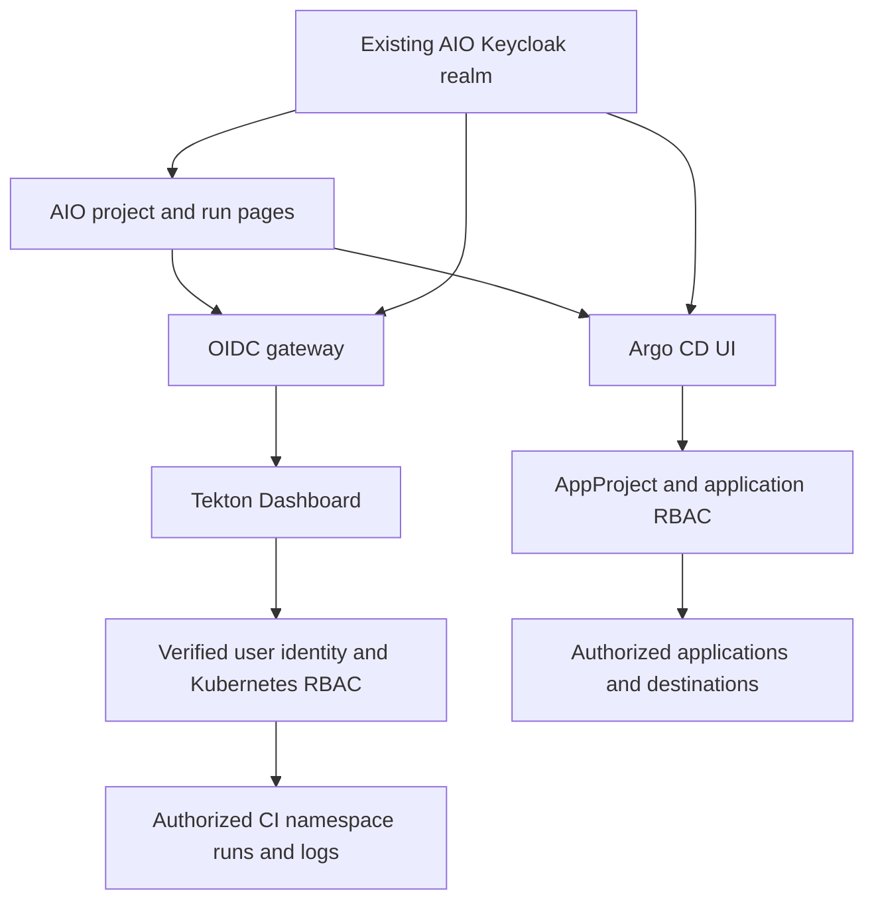

# User registries, artifact trust, and delivery tool UIs

**Status:** target architecture and test plan; partial local implementation delivered, live verification pending. **Date:** 2026-11-13. See [implementation status and activation](IMPLEMENTATION.md) for actual supported behavior and remaining work.

Extends [GitHub and independent delivery](GITHUB-AND-DELIVERY.md). The user has selected repository-based registry configuration with credentials stored separately. This document defines the next implementation scope, then a test gate before technology-specific deep dives.

## Current baseline

`application.yml` configures one platform registry prefix and one Tekton registry Secret. The Kaniko task accepts an image destination, mounts Docker authentication, and publishes an image digest. Source/GitOps and workload pull authentication still have shared-credential assumptions; see the [infrastructure credential inventory](../../infra/README.md). These must be split before supporting user credentials.

`bootstrap/install.sh` declares Tekton Pipelines v0.62.3, Dashboard v0.50.0, and Argo CD v2.12.4. These are repository defaults, not verified live versions. Inventory actual installations and review supported versions, security fixes, CRDs, and migration requirements before implementation; current upstream documentation may describe newer features.

The existing Argo `apps` AppProject allows several shared environment namespaces and broadly allows namespaced resource kinds. It does not define tenant isolation. The existing shared `ci` execution model must not become an unrestricted multi-user dashboard.

## Registry registration in the repository

Introduce a versioned `.aio/project.yaml`. The following is a **proposed contract**, not a file consumed by the current application:

```yaml
apiVersion: aio.platform/v1alpha1
kind: ProjectDelivery
spec:
  registry:
    mode: external
    host: ghcr.io
    repository: example-team/example-app
    credentials:
      pushConnection: project-image-push
      pullConnection: project-image-pull
  build:
    profile: standard-v1
  artifacts:
    requestedTier: verified
```

`mode: managed` selects the platform registry. An external host and repository select a user-owned destination. Connection names resolve only within the authorized AIO project; they are not Kubernetes Secret names or arbitrary secret-store paths. Users register credentials through an authenticated AIO connection flow, while the committed file records non-secret intent. Never commit passwords, tokens, Docker auth blobs, signing keys, or cloud service-account JSON. Prefer supported workload identity over static credentials.

Validate a strict schema, supported version, host/repository grammar, allowed fields, file size, and unknown fields. Reject embedded credentials, arbitrary URLs/ports unless explicitly supported, path traversal, and attempts to select another project's connection. Provider-specific adapters handle Docker Hub authentication conventions, GHCR, and supported cloud OCI registries. Do not infer registry credentials from a GitHub connection.

Parse configuration from the exact source commit and persist its hash and normalized effective settings with the build intent. Repository settings request permissions; platform policy grants them. Fork/PR changes cannot switch credentials, build profiles, destinations, or trust policy. Connection/destination changes require an authorized project configuration operation and validation before privileged builds run.

Registry validation checks TLS, repository scope, supported authentication, and capabilities. Registry requests must use controlled egress, block unintended internal/metadata endpoints, and revalidate DNS/redirect destinations; do not turn user registry registration into arbitrary network access. Private enterprise registries require an operator-approved network route and CA configuration. Never offer a user-controlled skip-TLS-verification switch.

Validate read capability without writes first. Where a push probe is necessary, use an explicit temporary artifact under the authorized repository and track cleanup; read-only validation alone does not prove push access. Discover signature, attestation/referrer, retention, and immutability support before enabling higher trust tiers. Track `PENDING_VALIDATION`, `READY`, `INVALID`, and `REVOKED` states with sanitized errors.

Separate credentials and lifecycles:

| Credential | Scope and exposure |
| --- | --- |
| Build push | Intended image/cache repository; available only to the authorized build execution |
| Scan/read | Read-only selected image; never reuse broad writer credentials for scanning |
| Workload pull | Read-only target image; provisioned in the actual workload namespace/cluster |
| Signing | Trusted signing controller/KMS identity; inaccessible to user build steps |
| GitOps write | Release worker only; independent of source and registry credentials |

Use per-run temporary Secrets where static credentials are required, avoid sharing writable credential volumes between untrusted tasks, disable unnecessary service-account token mounts, and sweep orphaned Secrets. Cache scopes must prevent cross-project poisoning or unauthorized reads. Rotate and revoke push/pull credentials separately. Disconnect blocks new builds/releases but does not remove pull credentials from running deployments until an explicit migration/cleanup operation has a safe replacement.

## Artifact tiers and control over Tekton

Treat artifact trust independently of registry ownership, subscription tier, and image tags. A user-owned registry can hold a golden image if evidence satisfies policy. A platform-owned registry does not make an image trusted automatically.

| Tier | Required evidence | Default use |
| --- | --- | --- |
| Normal | Recorded digest and source/run identity; basic validation and scan report | Isolated development only when the dev vulnerability gate passes; failed gates remain blocked |
| Verified | Normal plus approved builder/profile, passing tests and vulnerability policy, SBOM, verified signature and provenance binding source, builder, and digest | Staging and eligible dev deployments |
| Golden | Verified plus approved hardened base-image policy, current compliance evidence, and explicit authorized attestation/approval | Production-eligible; production release approval still required |

Golden is an organization policy designation, not a claim of a SLSA certification. Golden base images and golden application images are separate records: using an approved base does not certify the resulting application. Record tier decisions by digest, policy version, evidence references, evaluator, and time; tags such as `golden` are display aliases only. Users may request a tier but cannot grant it by editing YAML or labels.

Represent artifact availability, build success, evidence readiness, and release eligibility separately. Scanning, signing, or attestation storage can lag behind a successful build: releases wait for verified evidence without rerunning the build. Expired evidence, newly disallowed vulnerabilities, revoked signing identities, or an untrusted builder can block future releases and trigger review of existing deployments. Do not silently rebuild or roll back running applications.

Introduce an approved build-profile catalog owned by platform maintainers. A profile fixes versioned pipeline/task definitions, builder and utility image digests, resource/time limits, allowed parameters, network access, and service accounts. Users configure application inputs within that profile. They cannot supply arbitrary privileged TaskSpecs, service accounts, host mounts, secret bindings, or remote pipeline resolvers. Apply Kubernetes admission and RBAC so direct API requests cannot bypass AIO validation.

Enforce runner/task image allowlists separately from Dockerfile base-image and output-artifact policy. Multi-stage and dynamically resolved base images require builder evidence of resolved material digests; do not rely only on parsing `FROM`. If evidence cannot prove a required base policy, deny the elevated tier. Any permitted arbitrary test command still executes untrusted code and needs resource, network, filesystem, and credential isolation. Tenant/build isolation must precede broader user execution access.

Evaluate Tekton Chains for signed build provenance and OCI signatures, with protected KMS-backed signing and explicitly verified signer identity. Chains observes execution and signs results; signatures alone do not establish a safe build or passing policy. See [Chains capabilities](https://tekton.dev/docs/chains/) and [configuration](https://tekton.dev/docs/chains/config/). Validate the installed version and registry storage compatibility before relying on it. Evaluate [Tekton Trusted Resources](https://tekton.dev/docs/pipelines/trusted-resources/) for supported task/pipeline verification; it is separate from output-image trust.

The AIO release worker verifies digest-bound evidence before writing GitOps. Kubernetes admission provides a second enforcement point for deployed images, including attempts outside AIO. Choose and test a compatible open-source policy controller during implementation. Validate signature, expected issuer/key, provenance builder/source, and current environment policy; registry path or the presence of an attestation is insufficient. Production policy rejects tag-only references. Promotion copies must preserve digest and evidence and be reverified at the destination; do not assume different registries preserve signature attachments automatically.

## Argo CD UI using AIO identity

Use the upstream open-source Argo CD UI as a separate application, linked from AIO project/environment pages. Retain its application resource tree, namespace/destination details, desired/live diff, sync history, and health views. An **Open Argo CD** link targets the authorized application; deployment state remains visible in AIO as well.

Proposed host: `argocd.app.sarvaikam.com`, subject to DNS and certificate validation. Configure a dedicated confidential Keycloak client such as `aio-argocd` in the existing `aio` realm, direct OIDC login, exact callback `https://argocd.app.sarvaikam.com/auth/callback`, and separate client secret/session. Users select **Log in with AIO** and reuse the IdP session when available. AIO's cookie is not shared across tool domains. Follow the upstream [Keycloak integration](https://argo-cd.readthedocs.io/en/stable/operator-manual/user-management/keycloak/).

Provision minimal tool-specific claims from approved AIO membership and ownership. Use immutable subject IDs and platform-managed group identifiers, not email/name matching or user-editable groups. Reconcile entitlement changes and test revocation/token lifetime behavior for each client. An AIO login without an approved tool entitlement grants no tool access; another realm's users cannot enter.

Argo RBAC and AppProjects enforce access server-side. Create tenant/project-scoped AppProjects with exact repositories and allowed destinations, plus narrowly allowed resource kinds. Map viewers to application `get` only; logs are an explicit additional grant. Do not use global `role:readonly` as the default because it can expose other applications. Configure an empty default role and explicit grants. Keep anonymous access disabled. See [Argo RBAC](https://argo-cd.readthedocs.io/en/stable/operator-manual/rbac/).

Initially keep sync, rollback, override, resource actions, deletion, exec, and project/repository/cluster administration out of normal-user tool permissions. These could bypass AIO approvals or artifact policy. Production writes remain AIO release operations. Maintain a restricted, audited recovery/admin path with independently managed credentials.

Namespace filters are navigation conveniences. Argo AppProject/application RBAC governs visible applications; Kubernetes tenancy governs runtime resources. Shared `dev`, `staging`, and `prod` namespaces do not provide per-owner isolation. Plan dedicated tenant/project namespaces and least-privilege deployment identities, or document and test the limitations of any retained shared environment before user UI exposure. Allowing arbitrary namespaced RBAC/Secret workloads can undermine isolation even with AppProject boundaries.

## Tekton Dashboard using AIO identity

Use the upstream open-source Tekton Dashboard for PipelineRun graphs, TaskRuns, step logs, timing, and namespace views. Proposed host: `tekton.app.sarvaikam.com`; AIO run pages link to the corresponding authorized run.

Dashboard has no built-in authentication or authorization. Place an OIDC proxy/access gateway in front of it using a separate `aio-tekton-dashboard` Keycloak client in the same `aio` realm. With oauth2-proxy, the proposed callback is `https://tekton.app.sarvaikam.com/oauth2/callback`. Protect all UI, API, log, and streaming routes, and block direct backend access. The upstream [Dashboard access-control documentation](https://tekton.dev/docs/dashboard/install/) describes proxy authentication and Kubernetes authorization options.

Require per-user Kubernetes authorization through a compatible user-token setup or a constrained trusted impersonation gateway. For the initial design, evaluate impersonation with verified immutable subject/group mapping, strict header stripping, tightly constrained impersonation RBAC, and API network restrictions. Do not forward arbitrary browser-supplied `Authorization` or `Impersonate-*` headers. Proxy authentication alone with the Dashboard's shared broad ServiceAccount is insufficient.

Use tenant/project CI namespaces and namespace-scoped read permissions for runs/tasks and approved pod logs. A namespace selector or label filter is not an authorization boundary. Kubernetes RBAC cannot restrict list access by project label in shared `ci`. If the selected Dashboard/version cannot work with restricted namespace discovery and authorization, keep it operator-only until that is resolved; retain user run views in AIO.

Deploy Dashboard read-only with a minimally privileged backing identity, and enforce read-only access through RBAC as well. Build creation, retries, cancellation, and profile selection stay in AIO initially, preserving actor attribution, quotas, idempotency, registry checks, and artifact policy. Grant no access to Secrets, exec, arbitrary pod creation, or Pipeline/Task modification. Audit direct tool access and include identity, namespace, resource UID, and outcome without logging tokens.



## Implementation order, tests, and deep dives

Implement in a non-production environment, collecting evidence at each gate. No DNS, IdP client, live registry, cluster RBAC, or public UI changes are performed by this plan.

| Stage | Deliverable | Required test gate |
| --- | --- | --- |
| 1. Inventory and contracts | Actual component versions, identity claims, namespace/ownership map, registry schema, credential model | Version compatibility review; sample configurations validate and contain no secrets; denied config cannot resolve credentials |
| 2. Registry isolation | Scoped connections, validation, per-run push, scan/read and workload pull wiring | Managed/external registry paths; invalid/revoked auth; blocked destinations; token expiry; rotation; no cross-user credentials or cache leakage |
| 3. Build and artifact policy | Approved profiles, isolated execution, SBOM/provenance/signing and tier evaluation | Forged golden label, wrong signer, altered digest/source/builder, failed scan, stale evidence, missing referrers, privileged TaskSpec and direct API bypass all denied |
| 4. Argo SSO pilot | Dedicated OIDC client, TLS ingress, scoped AppProjects and read-only user links | Two unrelated users see only their applications via UI and direct API; no global list leak; denied sync/exec/rollback; valid login/callback/logout and role revocation |
| 5. Tekton SSO pilot | OIDC gateway, per-user authorization, isolated CI namespaces, read-only Dashboard | Two users cannot list/get/watch another tenant's runs or logs; header spoof and direct backend access denied; own graphs/logs work; Secret/exec/write permissions denied |
| 6. End-to-end recovery | GitHub source -> own registry -> evidence -> release -> GitOps -> healthy rollout | Restart/redelivery, registry outage, lost commit response, out-of-order completion, Argo outage, failed deployment, rotation and revocation recover without duplicate releases or policy bypass |

Test IdP client audience and issuer validation, exact callback allowlists, CSRF/state handling, session expiry, stale entitlement claims, and upstream logout independently for both tools. The IdP session and three application sessions have separate lifecycles; document which logout actions terminate each. Verify namespace permissions through direct APIs and not just screenshots. Use synthetic test tenants, short-lived credentials, and an explicit cleanup record; never publish token-bearing logs as evidence.

After all applicable gates pass, run deep dives in this order:

1. **Registry and OCI:** authentication, manifest/digest semantics, caches, pulls across clusters, signature storage, retention, rotation, recovery.
2. **Tekton:** Pipeline/Task execution, parameters/results, workspaces, identities, isolation, provenance, cancellation, retries, Dashboard authorization.
3. **Argo CD:** Applications/AppProjects, resource trees, Git reconciliation, sync/health, drift, namespace and cluster permissions, SSO, promotion/rollback.
4. **Keycloak and policy:** clients/claims, user lifecycle, entitlement projection, revocation, admission and artifact decisions.
5. **AIO orchestration:** ownership, outbox/leases, release state transitions, recovery, UI status, audit and observability.

Each deep dive produces a current-state diagram, version-specific configuration, one successful traced example, one failure/recovery exercise, a permission map, and follow-up tasks with acceptance criteria. Tests in this document are planned acceptance work, not completed test results.
